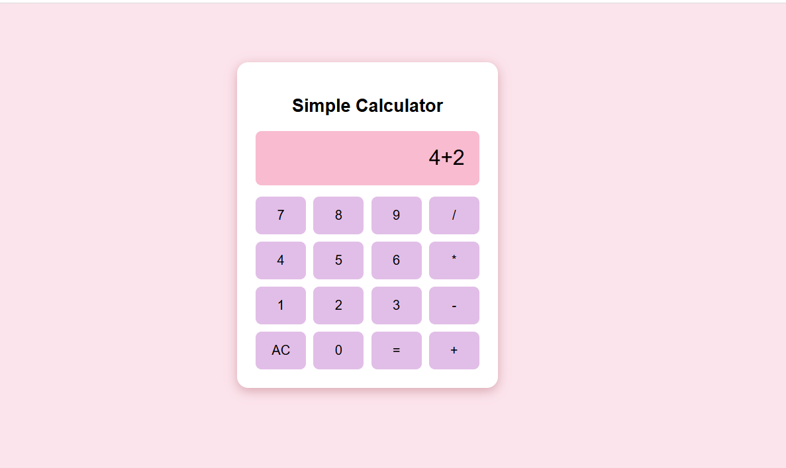
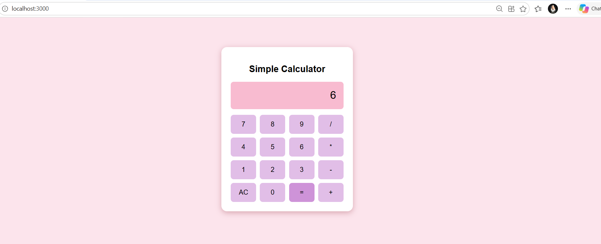

# Calculator_React
# Ex04 Simple Calculator - React Project
## Date:14-03-2026
## Name : Lohini S
## Reg No : 212225240079

## AIM
To  develop a Simple Calculator using React.js with clean and responsive design, ensuring a smooth user experience across different screen sizes.

## ALGORITHM
### STEP 1
Create a React App.

### STEP 2
Open a terminal and run:
  <ul><li>npx create-react-app simple-calculator</li>
  <li>cd simple-calculator</li>
  <li>npm start</li></ul>

### STEP 3
Inside the src/ folder, create a new file Calculator.js and define the basic structure.

### STEP 4
Plan the UI: Display screen, number buttons (0-9), operators (+, -, *, /), clear (C), and equal (=).

### STEP 5
Create a new file Calculator.css in src/ and add the styling.

### STEP 6
Open src/App.js and modify it.

### STEP 7
Start the development server.
  npm start

### STEP 8
Open http://localhost:3000/ in the browser.

### STEP 9
Test the calculator by entering numbers and operations.

### STEP 10
Fix styling issues and refine content placement.

### STEP 11
Deploy the website.

### STEP 12
Upload to GitHub Pages for free hosting.

## PROGRAM
### Calculator.js
```
import React, { useState } from "react";
import "./Calculator.css";

function Calculator() {
  const [display, setDisplay] = useState("0");

  const handleClick = (value) => {
    if (value === "AC") {
      setDisplay("0");
    } else if (value === "=") {
      try {
        setDisplay(String(eval(display)));
      } catch {
        setDisplay("Error");
      }
    } else {
      setDisplay(display === "0" ? value : display + value);
    }
  };

  return (
    <div className="calculator">
      <h2>Simple Calculator</h2>
      <div className="display">{display}</div>

      <div className="buttons">
        {["7", "8", "9", "/", "4", "5", "6", "*",
          "1", "2", "3", "-", "AC", "0", "=", "+"].map((btn) => (
          <button key={btn} onClick={() => handleClick(btn)}>
            {btn}
          </button>
        ))}
      </div>
    </div>
  );
}

export default Calculator;
```
### App.js
```
import Calculator from "./Calculator";

function App() {
  return <Calculator />;
}

export default App;
```
### Calculator.css
```
body {
  background: #fce4ec;
  font-family: Arial, sans-serif;
}

.calculator {
  width: 300px;
  margin: 80px auto;
  padding: 25px;
  background: white;
  border-radius: 15px;
  box-shadow: 0 4px 15px #d8a7b1;
  text-align: center;
}

.display {
  background: #f8bbd0;
  padding: 20px;
  font-size: 28px;
  text-align: right;
  border-radius: 8px;
  margin-bottom: 15px;
  overflow-wrap: anywhere;
}

.buttons {
  display: grid;
  grid-template-columns: repeat(4, 1fr);
  gap: 10px;
}

button {
  padding: 15px;
  font-size: 18px;
  border: none;
  border-radius: 8px;
  background: #e1bee7;
  cursor: pointer;
}

button:hover {
  background: #ce93d8;
}
```

## OUTPUT
### Output1


### Output2


## RESULT
The program for developing a simple calculator in React.js is executed successfully.